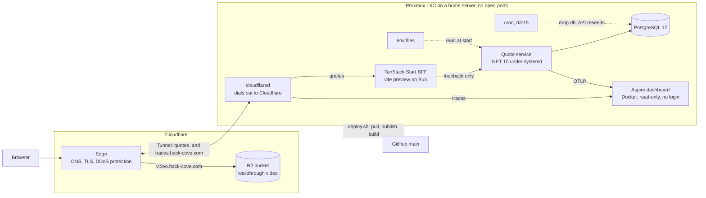

# advisor-quotes

Advisor Quotes is a tech demo: an adviser quote service (C#/.NET 10 + PostgreSQL, with a TanStack Start BFF on
`@hackcove/ui`) that shows domain modelling, idempotent commands, optimistic concurrency, tracing and testing at every
layer. Design notes are in [`SOLUTION.md`](SOLUTION.md).

A hosted copy runs at <https://quotes.hack-cove.com>; the **Traces** link in its header opens the trace viewer, and its
About page links the walkthrough. How it
is hosted is under [The hosted demo](#the-hosted-demo).

## Run locally with Nx

Nx is the default way to run everything here. To run only the .NET side with nothing but the SDK and a PostgreSQL, see
[Fallback: .NET and PostgreSQL only](#fallback-net-and-postgresql-only).

Prerequisites: [mise](https://mise.jdx.dev) (installs the .NET 10 SDK pinned in `mise.toml` and `global.json`),
[Bun](https://bun.sh) 1.4+, Docker with Compose.

```bash
mise install                 # the pinned .NET SDK
bun install
cp .env.example .env         # if 5432 is taken, change POSTGRES_PORT and the port in ConnectionStrings__Quotes
docker compose up -d         # PostgreSQL with a named volume and a healthcheck
```

Nx reads `.env` itself, so the targets below need no `export`. Start the API and the web app, each in its own terminal:

```bash
bunx nx run Api:run          # http://localhost:5180; migrates and seeds on start
bunx nx dev web              # http://localhost:3000
```

`bunx nx show project Api` lists the targets `@nx/dotnet` infers. The web app is a TanStack Start server that calls the API itself (the browser never does); it reads `QUOTES_API_URL`.

With `Database__SeedDemoData=true` (set in `.env.example` and `appsettings.Development.json`) the API writes eight demo quotes
across the three advisers on startup, covering every status, but only when the `quotes` table is empty. They are built
through the domain and Pricing, so premiums and histories are real. Walk the whole flow with curl, one line per call:

```bash
scripts/demo.sh                                   # needs curl and jq; API_URL overrides the default
curl -H 'X-Adviser-Id: ADV-001' http://localhost:5180/v1/queries/list-quotes
```

Other commands:

```bash
bunx nx run-many -t build test typecheck lint     # the gate
bunx nx e2e web-e2e                               # Playwright, see below
docker compose --profile observability up -d      # adds the Aspire dashboard, see below
bunx nx show projects                             # Api, Api.Tests, Api.IntegrationTests, Pricing, Pricing.Tests, web, web-e2e
```

### Environment variables

| Variable | Read by | Default | Purpose |
|---|---|---|---|
| `ConnectionStrings__Quotes` | API | none; without it the API fails at startup when `Database__MigrateOnStartup` is on (the Development default), otherwise on the first request that needs the database | Npgsql connection string |
| `Database__MigrateOnStartup` | API | `true` in Development | Apply EF migrations on start |
| `Database__SeedDemoData` | API | `true` in Development | Write the demo quotes when `quotes` is empty |
| `QUOTES_API_URL` | web | `http://localhost:5180` | Where the web server functions reach the API |
| `DEMO_VIDEO_URL`, `DEMO_TRACES_URL` | web | unset: the About page shows the repo links only | The walkthrough video and the trace viewer, linked from the About page of the hosted demo |
| `DEMO_RESETS_NIGHTLY` | web | unset | `true` on the hosted demo: the About page says the data resets every night |
| `OTEL_EXPORTER_OTLP_ENDPOINT` | API, web | unset: the API makes spans but does not export them; the web app makes none | OTLP/gRPC endpoint, `http://localhost:4317` for the Aspire dashboard |
| `OTEL_SERVICE_NAME` | API | `advisor-quotes-api` | Service name on spans and logs |
| `OTEL_BSP_SCHEDULE_DELAY` | API, web | `5000` | Milliseconds finished spans wait before they are sent; `500` shows a trace within about a second. `OTEL_BLRP_SCHEDULE_DELAY` does the same for the API's log records |
| `OTEL_WEB_SERVICE_NAME` | web | `advisor-quotes-web` | The web app's service name; its own variable, because `.env` is shared |
| `POSTGRES_DB`, `POSTGRES_USER`, `POSTGRES_PASSWORD`, `POSTGRES_PORT` | `docker compose` | `quotes`, `quotes`, `quotes`, `5432` | The compose Postgres |

## Follow a quote through the system

One trace follows a user action from the web app to the database. The web app (`advisor-quotes-web`) makes a span per
page load or server-function call, one per server function, and a client span per API call that sends `traceparent`, so
the API (`advisor-quotes-api`) continues the same trace with a span per request, per command or query, per price
calculation and per SQL command. The API also writes JSON log lines that carry the trace id. The [.NET Aspire dashboard](https://aspire.dev/dashboard/overview/) shows both. It is
opt-in; the plain `docker compose up -d` stays Postgres only.

1. **Start the dashboard and point both apps at it.** In `.env` uncomment `OTEL_EXPORTER_OTLP_ENDPOINT=http://localhost:4317`, then:

   ```bash
   docker compose --profile observability up -d     # Postgres plus the dashboard
   bunx nx run Api:run
   bunx nx dev web
   ```

   Open <http://localhost:18888>. No login; both ports are bound to loopback.

2. **Create a quote.** A create needs an `Idempotency-Key` and an adviser. The response header `X-Trace-Id` is the trace id.

   ```bash
   curl -si http://localhost:5180/v1/commands/save-quote \
     -H 'Content-Type: application/json' -H 'X-Adviser-Id: ADV-001' -H "Idempotency-Key: $(uuidgen)" \
     -d '{"clientName":"Demo Client","clientDateOfBirth":"1985-04-12","clientIsSmoker":false,"productCode":"LIFE","coverAmount":500000,"termYears":20}'
   ```

   Copy the `X-Trace-Id` from the response headers. Or create the quote in the web app at <http://localhost:3000>; its
   trace then starts at the web app's `POST server fn saveQuote` span.

3. **Find the trace.** Dashboard → **Traces**, service `advisor-quotes-api`; or paste the `X-Trace-Id` into the filter box. Open
   the `POST v1/commands/save-quote` row, or the `POST server fn saveQuote` row for a create made in the web app.

4. **Read it top down.** From the web app, the trace starts with `POST server fn saveQuote`, then `fn saveQuote`, then the
   web app's call to the API (Aspire labels it `HTTP POST 200`), whose child is the API's request span. The API's request span holds a `command SaveQuote` span, tagged with `quote.id`, `adviser.id`,
   `product.code`, `quote.save.mode` (`create`), `quote.status.to` and `outcome`. Beside and under it: a `price` span (the premium
   calculation) and the Npgsql spans for the adviser lookup, the idempotency lookup and the insert. Replay the same curl with the same
   key and the command span reads `idempotency.replayed=true` and nothing is inserted. Spans carry ids and codes, never the client's name or date of birth.

5. **Jump to its log lines.** In the trace's detail pane choose **View logs**, or open **Structured logs** and filter on the trace id.
   The lines are the same log entries the API prints to its console as JSON (EF Core's "Executed DbCommand" lines for a create), here as structured records linked to the span that wrote them.

Stop the dashboard with `docker compose --profile observability down`. Spans and logs are held in memory, so they are gone after a restart.

## Integration tests

`apps/api-integration-tests` runs against a real PostgreSQL, in its own database `quotes_it` (EF creates it and applies the
migrations on the first run; each test runs in a transaction that is rolled back). With
`ConnectionStrings__QuotesIntegration` unset, every test is skipped with the reason, so the commands above need no database.

```bash
docker compose up -d
export ConnectionStrings__QuotesIntegration='Host=localhost;Port=5432;Database=quotes_it;Username=quotes;Password=quotes'
bunx nx test Api.IntegrationTests     # or: dotnet test apps/api-integration-tests
```

## End-to-end test

`apps/web-e2e` drives the real stack in Chromium with Playwright. Ten independent tests cover creating a quote (the
exact premium, the list row and the stored row), editing a Draft, server validation shown in the form, a create whose
response is lost and is retried with the same Idempotency-Key, send and accept, a decline that needs a reason, a move
refused from a stale page, the adviser picker, another adviser's quote by URL, and the status filter. Each test sets up
what it is not about through the API (`tests/fixtures.ts`) and does what it is about in the browser. It starts the API
(on 5181, migrations on, demo seed off) and the web app (on 3001) itself, against the compose Postgres in its own
database `quotes_e2e`, which EF creates on the first run. Every test has its own fixed client names (no random data, so pages look the
same on every run), and deletes the quotes an earlier run left under them before it starts, so tests run in parallel and
reruns share the database safely. `--repeat-each` runs copies of one test at once, so use it with `--workers=1`. It is not part of the gate above.

```bash
docker compose up -d
bunx playwright install chromium     # once, from apps/web-e2e
bunx nx e2e web-e2e
```

Point it at another Postgres with `ConnectionStrings__QuotesE2E`. A failure leaves a trace and a screenshot in
`apps/web-e2e/test-results`.

## The hosted demo

The AWS design in [`SOLUTION.md`](SOLUTION.md#aws-plan) is how this would run in production. The public demo is
smaller: one Linux container on a home Proxmox server, published through Cloudflare. Nothing on the server is open to the
internet; Cloudflare is the only way in.



- **Cloudflare Tunnel.** `cloudflared` in the container dials out to Cloudflare and holds the connection open, so the
  home router forwards no ports and the server has no public address. The tunnel is managed from the Cloudflare
  dashboard: it maps `quotes.hack-cove.com` to the web app and `traces.hack-cove.com` to the Aspire dashboard, and
  Cloudflare terminates TLS on both. Each hostname is a proxied CNAME to the tunnel.
- **The same layering as AWS.** The browser reaches only the web app, which calls the API on loopback; the API is not
  published at all. In the AWS plan CloudFront and an internal ALB play these parts.
- **Processes.** Three systemd units, each reading its settings from an environment file under `/etc/advisor-quotes` (the checkout and published output live in `/opt/advisor-quotes`), outside the repo:
  `advisor-quotes-api` (the published API), `advisor-quotes-web` (the built web app under `vite preview`) and `advisor-quotes-tunnel`.
  The API runs as `Production` with `Database__MigrateOnStartup` and `Database__SeedDemoData` on, against a PostgreSQL in
  the same container. The web app sets `DEMO_TRACES_URL`, `DEMO_RESETS_NIGHTLY` and (once the video is up) `DEMO_VIDEO_URL` for the About page,
  and `__VITE_ADDITIONAL_SERVER_ALLOWED_HOSTS=quotes.hack-cove.com`, without which `vite preview` refuses the public host.
- **Traces.** The Aspire dashboard runs in Docker with a 400 MB memory cap and no login, so the header's Traces link
  opens it straight away and anyone can follow their own request end to end. That is safe enough here because spans
  carry ids and codes, never client details, and its OTLP port is on loopback, so only the API can send to it. Anyone
  can clear the traces, which costs nothing but the history. Behind the tunnel
  the dashboard sees plain `http`, so it runs with `ASPNETCORE_FORWARDEDHEADERS_ENABLED=true` and
  `Dashboard__Frontend__PublicUrl`; without them it refuses the `https` origin's WebSocket and its pages stay empty. It is pinned to 13.5.2, as is
  `docker-compose.yml`: 13.6.1 counts the traces but draws an empty list. Spans are kept in
  memory and carry no client details (see [Follow a quote through the system](#follow-a-quote-through-the-system)).
- **Video.** The walkthrough is a file in a Cloudflare R2 bucket served on its own custom domain, so the home
  connection never streams it.
- **Deploys.** A script in the container pulls `main`, runs `dotnet publish` and `bun run build`, then restarts the
  two app units. There is no CI deploy; the gate runs before the push.
- **Resets.** Anyone can create and change quotes, so a cron job drops the database at 03:15 every night and restarts
  the API, which migrates and seeds the eight demo quotes again.

What it leaves out, on purpose: one container is one point of failure, there is no backup (the data is thrown away
nightly), secrets are files readable only by root and the service account rather than a secrets manager, and there is
no rate limit beyond Cloudflare's own DDoS protection. For a public demo that is enough; the AWS plan covers the rest.

## Fallback: .NET and PostgreSQL only

For anyone who would rather not install Bun or Nx. Needs the .NET 10 SDK (`global.json` pins 10.0.402) and a PostgreSQL: one you already have, or `docker compose up -d postgres`. No `node_modules`.

```bash
export ConnectionStrings__Quotes='Host=localhost;Port=5432;Database=quotes;Username=quotes;Password=quotes'
dotnet build AdvisorQuotes.slnx
dotnet test AdvisorQuotes.slnx            # integration tests skip unless ConnectionStrings__QuotesIntegration is set
dotnet run --project apps/api                   # http://localhost:5180; migrates and seeds on start
```

The role must be able to create the database and its tables (compose already creates the database). Then `curl http://localhost:5180/health`,
`curl -H 'X-Adviser-Id: ADV-001' http://localhost:5180/v1/queries/list-quotes`, or `scripts/demo.sh`. The web app runs without
Nx as `bun install && bun --cwd apps/web dev`.
