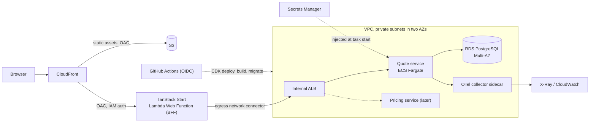

# Solution

## Design and trade-offs

**Boundaries.** `libs/pricing` is a pure library: a request in, a premium or a typed rejection out, with no I/O, clock or framework. The quote service (`apps/api`) owns quotes, status and persistence, and calls Pricing in process. Splitting Pricing into its own service later changes its two call sites, not the formula. The web app (`apps/web`) is a backend-for-frontend: the browser talks only to its server functions, and only `quotes-api.ts` knows the API's address. The browser never calls the API, so the API needs no CORS.

**Premium calculation.** A deliberately simple rate table: `premium = (cover ÷ 1,000) × age-band rate × smoker loading × term factor × product multiplier`, in exact `decimal`, rounded once to 2 dp. Age is in completed years, 18–65, in five bands. Smokers pay ×1.5. Terms of 1–10, 11–20 and 21–30 years step the factor up. `DISABILITY` costs ×1.4 of `LIFE`. Out-of-range ages, covers, terms and unknown products are typed rejections, which the API returns as validation errors. Every premium is stored with its `pricing_version`. The full table and a worked example are in [`libs/pricing/README.md`](libs/pricing/README.md).

**CQRS, hand-rolled.** Commands are `POST /v1/commands/<task>` and queries are `GET /v1/queries/<task>` (`save-quote`, `send-quote-to-client`, `accept-quote`, `decline-quote`, `get-quote`, `list-quotes`, `list-advisers`). Each is one handler behind `ICommandHandler`/`IQueryHandler`, registered by hand in `Program.cs` and reached through a controller that takes it as a constructor parameter. It returns a `Result` whose typed `Failure` becomes one ProblemDetails status in one place. The controller base class wraps every handler in a trace span. There is no MediatR and no reflection: the plumbing is a few small files. Commands load the `Quote` aggregate through EF Core. Queries use the same `QuotesDbContext` but never touch the domain: they are untracked reads that go straight into response DTOs. Both sides use the same Postgres database, so a read always sees the last write. I started the query side on Dapper and took it out: three single-table reads of at most 100 rows did not justify a second data-access stack, a second connection pool and SQL strings that can drift from the EF mapping. Dapper is still the right tool when a read gets complicated, and quotes are where that happens. Real quotes can be deeply nested, and from experience EF struggles with reads shaped like that; explicit SQL is easier to write, to read and to tune. If this read model grows that way, I would put that one query back on Dapper and leave the rest on EF. A separate read store (a projection or a replica) is the next step if reads and writes ever need to scale apart.

The URLs name tasks, not resources, so a create answers 200 with the new id and no `Location` header: it is a command, not a resource. Status moves are three commands rather than a `PATCH status`. Each says what happened, and Decline alone requires a reason.

**Data model.** `quotes` holds the client, product, `premium`, `currency`, `pricing_version` (the rate table that priced it, so an old premium can still be explained), `status`, timestamps, notes, and the idempotency key and request hash. `quote_status_changes` holds from, to, reason, who and when, starting with the creation as `null → Draft`. `advisers` holds three advisers, seeded by the migration. Quote ids are v7 Guids. `xmin` is the concurrency token, so if two requests change the same quote at once (two tabs, a double submit), the second save gets a 409 instead of overwriting the first.

**Status machine.** Draft → SentToClient → Accepted or Declined, and Draft → Declined. Accepted and Declined are terminal. `QuoteStatusRules` is the only place that says this, and `Quote.ChangeStatus` is the only way the status moves, so the history stays complete. An illegal move is a 409.

**Saving a quote.** `save-quote` is an upsert. With no `quoteId` it creates a Draft. With an id it replaces the details of a Draft the adviser owns, and it reprices the quote. Age is taken at the quote's creation date, so an edit never moves the client into another age band. An edit can still change a premium the adviser has already seen, so after saving, the UI goes to the quote's detail page, which shows the stored premium. Edits are not versioned: history records status changes only.

**Identity.** The caller is the `X-Adviser-Id` header. No header gives a 401, and an unknown adviser gives a 403. The per-request lookup against `advisers` stands in for a validated Cognito/JWT claim, which would replace the header and keep the same `ICurrentAdviser` seam. Every quote read and write is scoped to the caller, and another adviser's quote is a 404, not a 403, so ids cannot be probed.

A quote's reference, `Q-yyyyMMdd-XXXX`, takes its four hex digits from the random part of the quote's v7 Guid, so two quotes on the same day share a reference about once in 65,536 pairs. It is a label for people, not a key: everything looks quotes up by id. In production the reference would get a unique index and a retry on collision, or more digits.

**Duplicate submissions.** A create requires an `Idempotency-Key` header, and without one it is a 400. The key and a SHA-256 of the command are stored on the quote under a unique index on (adviser, key). Reusing a key with the same command returns the existing quote as it is now, with `Idempotent-Replayed: true`. Reusing it with a different command is a 422. Two simultaneous creates both insert, the index rejects the second, and that request returns the first's quote, so there is no check-then-insert race. An update names its quote by id, so it is idempotent already and ignores the key.

A short time window is the obvious way to detect a duplicate, and I chose a required key instead. A window has to guess intent: if the same client, product and cover arrive twice within N seconds, the window assumes a retry, though two real quotes can look identical. A key makes the client say "this is the same submission", and the form holds one key until a save succeeds, so a double click or a retry after a timeout reuses it. The cost is that every client must send a key. Keys never expire here. A production service would clear them after a retention window (a day is common) and would decide whether to store the replayed response instead of returning the current state.

**Migrations.** EF Core migrations run on startup when `Database__MigrateOnStartup` is true (on in development), so `docker compose up` and `dotnet run` give a working schema. That is fine for a single local instance. With several instances or a rolling deploy they would race, which is why the AWS plan runs a migration bundle as a separate step. `Database__SeedDemoData` writes eight demo quotes, through the domain and Pricing, when the table is empty.

**The signal is tracing.** The design goal is to follow one user action through the back end, and a trace does exactly that. Each request gets a span with a `command <Name>` or `query <Name>` span under it, the SQL spans and, on a save, a `price` span, with the timing and the outcome on each. Every response carries `X-Trace-Id`, so an operator can start from a response. JSON logs carry the same trace id, so the two signals link up. A create and a later status change are separate traces, joined by the `quote.id` attribute. Logs alone would need that correlation built by hand. Tracing gets it from OpenTelemetry.

**Health.** `/health` is liveness: the process answers, and nothing else is checked. `/health/ready` is readiness: it returns 503 when the database cannot be reached, so a load balancer stops routing to an instance that cannot serve quotes. It checks only connectivity, not migrations or query latency, and it runs on every probe. A production deploy would add a timeout and a cached result before the probe rate grows.

**Tests.** The gate runs with no database and no network:
- Pricing unit tests cover the formula and every rejection.
- Domain tests cover the status rules.
- Handler tests use the EF Core in-memory provider through the same `QuotesDbContext` the handlers use; the unique-index and row-version behaviour is covered by the integration tests against Postgres.
- Endpoint tests use `WebApplicationFactory`, with fake handlers on the query side.
- The web app's Vitest tests inject a fake `fetch` into the BFF client.

The integration tests run against a real Postgres and skip when no database is configured. They cover the EF mapping, all three queries, the `xmin` conflict and two racing creates with the same key. The in-memory provider used by the handler tests enforces neither the unique index nor the row version, so these are the only tests that prove them. Inside the default gate, `apps/api-tests/Persistence/QuotesModelTests.cs` guards the EF mapping itself against the migrations, with no database. The Playwright suite drives the real stack through every flow a user has: create, edit, send, accept, decline, the adviser picker and the status filter. It also covers the failures a user can meet: server validation, a stale page refused with a 409, another adviser's quote opened by URL, and a create whose response is lost and is retried with the same key. It asserts exact premiums and checks the stored rows through the API. Running it in parallel caught a real bug: the quote history came back in whatever order Postgres stored it, not oldest first. An integration test now pins that. The suite sits outside the gate.

Some things are not tested:
- Trace export to a collector. No test asserts it; the README walks through it in the Aspire dashboard.
- Load, and races beyond the two above.

**Out of scope.** Revision history for Draft edits, a separate read store, Pricing as its own service, authentication, and pagination beyond the newest 100 quotes.

**What I'd add for production.**
- A JWT/Cognito claim instead of `X-Adviser-Id`.
- A retention window on idempotency keys.
- The integration tests and e2e running in CI against an ephemeral Postgres.
- Cursor pagination on `list-quotes`.
- Revision history once an edit to a priced quote matters to compliance.
- Metrics (request rate, errors, latency) next to the traces.

## AWS plan

Described, not deployed. Region: Cape Town (`af-south-1`) for data residency; I have not checked that every service below is offered there.

- **Edge and BFF.** CloudFront serves static assets from S3 and sends everything else to the web app on a Lambda Web Function, restricted to the distribution with origin access control. A Web Function runs an ordinary Node.js HTTP server (Node-only, and new, so the part to re-check before building). I chose it over a plain Lambda function URL because that route needs the viewer to send an `x-amz-content-sha256` on every POST, which a browser cannot do for server functions.
- **The API has no public address.** The web function reaches the quote service through an egress network connector into the VPC, then an internal ALB, whose nodes have only private IPs. The ALB's security group admits only the connector's. The API has no authentication (out of scope), so that network position is its only gate.
- **Quote service.** ECS Fargate in private subnets behind the ALB. Image pulls from ECR go over VPC endpoints or a NAT gateway.
- **Database.** RDS PostgreSQL as a Multi-AZ DB instance deployment: a synchronous standby in another AZ for failover. The connection string lives in Secrets Manager as one secret and ECS injects it as `ConnectionStrings__Quotes` through the task execution role, so the code does not change. ECS reads it only when a task starts, so a rotation needs a forced new deployment.
- **Observability.** Tracing is OpenTelemetry over OTLP, so AWS changes only where the exporter points. A collector sidecar (the ADOT distribution) receives OTLP and forwards traces to the X-Ray OTLP endpoint, signed with SigV4 by the task role. Every command and query handler runs in its own span with its outcome as an attribute, and the API logs one JSON object per line to stdout (CloudWatch Logs via the task's log driver) with the trace and span id on each, so a log line and its trace find each other. Spans and logs carry ids and codes only, never a client's name or date of birth.
- **Migrations.** `Database__MigrateOnStartup` stays off. The pipeline builds an EF Core migration bundle and runs it as a one-off ECS task before the service updates. Migrations must be backward compatible, because old and new tasks overlap during a rolling deploy.
- **Demo data.** `Database__SeedDemoData` is a development convenience and stays off outside it; the seeder is not a migration, and no environment with real clients should ever run it.
- **Delivery.** CDK for infrastructure, images in ECR, GitHub Actions authenticating to AWS with OIDC and no stored keys.
- **Pricing split.** `Pricing` is already its own library. To split it out, run it as a second ECS service behind the same internal ALB, selected by a path or host listener rule.

**Fargate or Lambda for the API.** I picked Fargate: an always-on, normal server that keeps its own EF Core connection pool and has no cold start, at the cost of paying for idle capacity. The API on Lambda scales to zero and bills per use, but a cold start lands on the first request, and many short-lived environments each open connections, which AWS recommends fronting with RDS Proxy (extra cost and a moving part). Lambda has a managed .NET 10 runtime, so the choice is a deployment decision and the application code does not change.

## An LLM in the quote flow

I would put a model at the edges of the flow and never in the premium calculation. Two uses fit: extracting proposed quote fields (product code, cover amount, term, smoker) from the free-text advisor notes into a pre-filled draft, and drafting the client-facing summary of a stored quote. In both the model only proposes: extracted fields go through the same validation as a hand-typed quote and the premium is still computed by the pricing library, and a summary is checked so its premium equals the stored one and sits as an editable draft until the advisor approves it, before a quote moves from Draft to Sent to client. Cost is per call and small next to an advisor's time, but it grows with volume, so I would call on demand rather than on every save. Latency is seconds, so it runs outside the create request, with the advisor editing while it runs. The real constraint is privacy: client name and date of birth are personal information under POPIA, so I would send only the fields the task needs, redact identifiers, keep inference in the region the data must stay in (checking where the provider actually runs it), and log the model version, prompt and output for audit.
